# Lapakinku — Katalog Digital, Kasir POS & Engine Bagi Uang Laci UMKM

[](https://lapakinku.my.id/)
[](https://lapakinku.my.id/lapakinku-v1.0.0.apk)
[](LICENSE)
[](https://reactjs.org/)
[](https://vitejs.dev/)
[](https://capacitorjs.com/)
[](https://tailwindcss.com/)
[](https://nodejs.org/)

> **"Jualan rapi, modal aman, cukup lewat WhatsApp."**  
> Platform terintegrasi Web Application (PWA) + Android Native APK untuk jutaan UMKM kuliner dan pedagang ritel di Indonesia.
>
> 🔒 **Repository Publik (Dokumentasi & Arsitektur):** Repositori ini memuat spesifikasi sistem, diagram alur arsitektur (Mermaid flowcharts), katalog fitur lengkap beserta visualisasi antarmuka, panduan pengembang, dan tautan unduhan APK resmi. Seluruh *source code* inti disimpan secara privat.

---

## 🌐 Tautan Resmi Produksi

- **Aplikasi Web Utama (Live Production):** [https://lapakinku.my.id/](https://lapakinku.my.id/)
- **Katalog Uji Coba Pedagang (Live Demo):** [https://lapakinku.my.id/dimsume](https://lapakinku.my.id/dimsume)
- **Unduh Android APK Resmi (v1.1.6 Build 16):** [https://lapakinku.my.id/lapakinku-v1.0.0.apk](https://lapakinku.my.id/lapakinku-v1.0.0.apk)

---

## 📌 Daftar Isi
1. [Latar Belakang & Nilai Utama](#-latar-belakang--nilai-utama)
2. [Tangkapan Layar & Antarmuka Utama](#-tangkapan-layar--antarmuka-utama)
3. [Arsitektur Sistem & Diagram Alur (Flowcharts)](#-arsitektur-sistem--diagram-alur-flowcharts)
   - [1. Arsitektur Keseluruhan Sistem](#1-arsitektur-sistem-keseluruhan)
   - [2. Alur Belanja Pembeli & Checkout WhatsApp](#2-alur-belanja-pembeli--checkout-whatsapp)
   - [3. Alur Engine Bagi Uang Laci Otomatis](#3-alur-engine-bagi-uang-laci-otomatis)
   - [4. Alur Gateway Bot WhatsApp Native (Baileys Engine)](#4-alur-gateway-bot-whatsapp-native-baileys-engine)
   - [5. Alur Push Notification & Lonceng Kasir](#5-alur-push-notifications--lonceng-kasir)
4. [Katalog 12 Fitur Unggulan](#-katalog-12-fitur-unggulan)
5. [Teknologi yang Digunakan](#-teknologi-yang-digunakan)
6. [Struktur Direktori Proyek](#-struktur-direktori-proyek)
7. [Panduan Instalasi & Pengembangan Lokal](#-panduan-instalasi--pengembangan-lokal)
8. [Panduan Kompilasi Android APK](#-panduan-kompilasi-android-apk)
9. [Panduan Deployment VPS (Production)](#-panduan-deployment-vps-production)
10. [Lisensi](#-lisensi)

---

## 💡 Latar Belakang & Nilai Utama

Masalah terbesar pedagang kuliner dan UMKM di Indonesia bukan kekurangan pembeli, melainkan **pengelolaan arus kas harian dan friksi teknologi**:
1. **Uang Laci Campur Aduk:** Modal belanja bahan baku dan keuntungan bersih bercampur di satu tempat. Tanpa disadari, uang modal terpakai untuk konsumsi pribadi sehingga pedagang tekor saat belanja bahan baku esok pagi.
2. **Ketergantungan Komisi Ojek Online yang Mencekik:** Biaya potongan 20%–30% dari platform pesan-antar memotong tipis margin laba makanan UMKM.
3. **Aplikasi Kasir Konvensional Terlalu Rumit:** Butuh perangkat POS mahal, biaya langganan bulanan tinggi, dan sulit dioperasikan oleh pegawai warung pemula.

**Lapakinku menyelesaikan ketiga masalah di atas secara fundamental:**
- **Katalog WhatsApp Mandiri Tanpa Potongan Komisi:** Pembeli memilih menu langsung via web browser tanpa harus menginstal aplikasi. Pesanan langsung masuk rapi ke WhatsApp pedagang.
- **Engine Bagi Uang Laci Otomatis:** Setiap transaksi langsung dipecah secara *realtime* menjadi **Modal Belanja Besok (HPP)** yang wajib disisihkan dan **Untung Bersih** yang aman dinikmati.
- **Gateway Bot WhatsApp Native (Baileys Engine):** Mengirimkan konfirmasi pesanan dan struk digital otomatis langsung dari nomor WhatsApp resmi toko.
- **Mesin Kasir POS Offline-First:** Kasir tetap bisa mencatat transaksi di tengah sinyal hilang dan otomatis tersinkronisasi saat koneksi pulih.
- **Sistem Desain Vektor Murni (Zero-Emoji):** 100% menggunakan SVG Lucide Icons yang konsisten di semua jenis layar Android, iOS, dan desktop tanpa risiko emoji rusak (*broken glyph*).

---

## 📸 Tangkapan Layar & Antarmuka Utama

| Katalog Pembeli (Pintar & Jam Toko) | Dashboard Ringkasan Laci | Laporan Bagi Uang Laci & Jam Ramai |
| :---: | :---: | :---: |
| 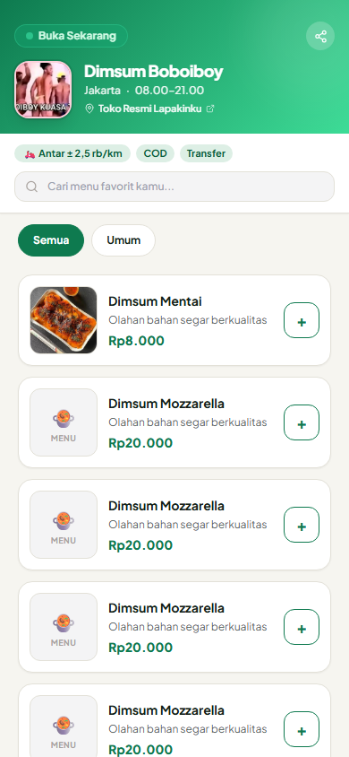 | 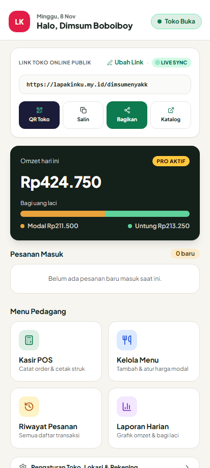 | 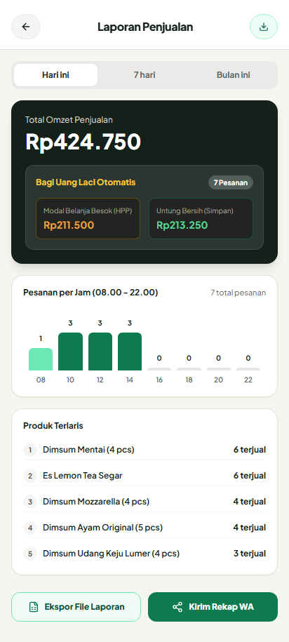 |
| *Status jam buka/tutup dinamis, vektor SVG, GPS ongkir.* | *Pemisahan HPP vs Untung Bersih & rasio visual.* | *Visualisasi jam sibuk (08.00–22.00) & ekspor Excel.* |

| Gateway Bot WhatsApp (Baileys Engine) | Tema Kustom: Bistro Amber | Tema Kustom: Midnight Modern |
| :---: | :---: | :---: |
| 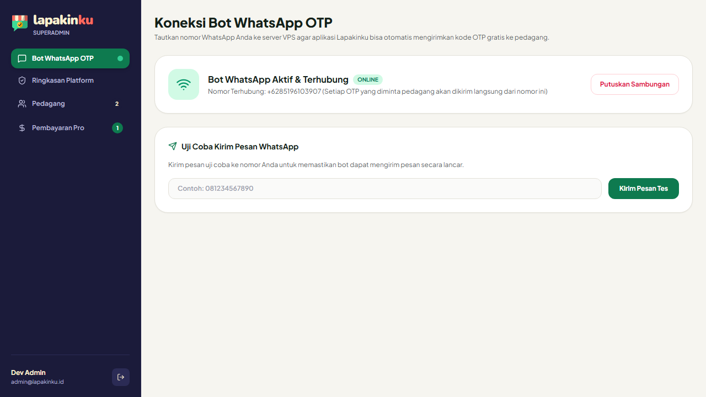 | 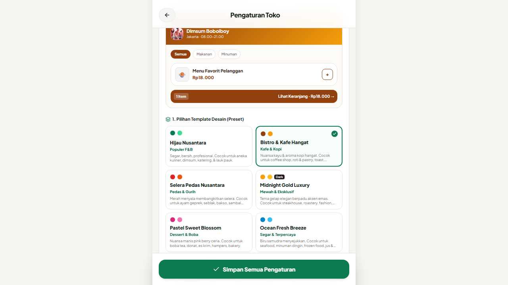 | 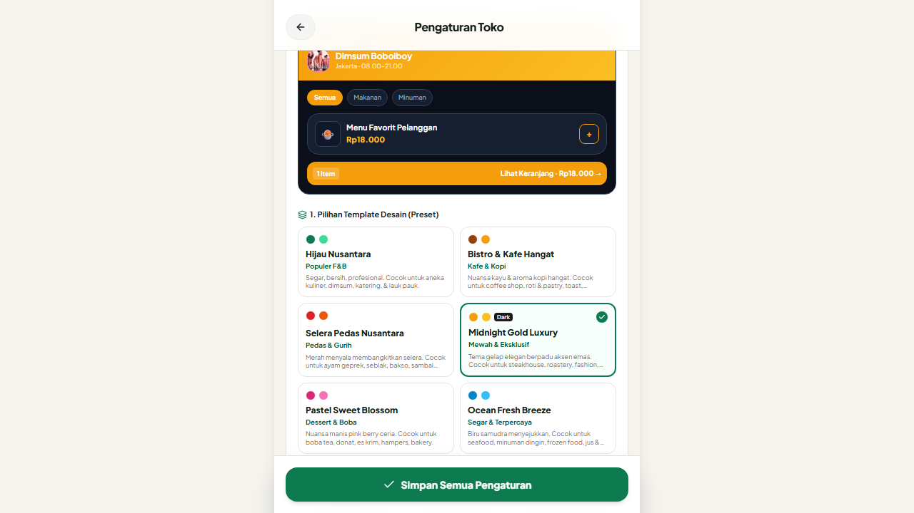 |
| *Koneksi multi-device WhatsApp via scan QR instan.* | *Nuansa hangat kuliner roti & kedai kopi.* | *Tampilan malam modern kontras tinggi.* |

---

## 📊 Arsitektur Sistem & Diagram Alur (Flowcharts)

### 1. Arsitektur Sistem Keseluruhan

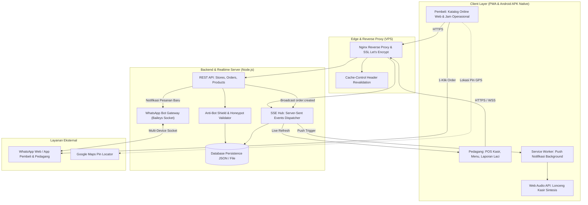

---

### 2. Alur Belanja Pembeli & Checkout WhatsApp

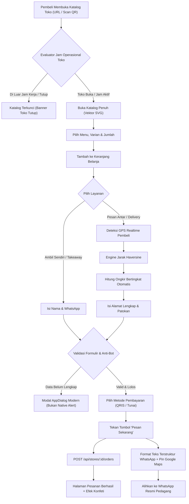

---

### 3. Alur Engine Bagi Uang Laci Otomatis

```mermaid
flowchart LR
    subgraph Ingest["Input Transaksi Kasir & Pembeli"]
        Omzet["Total Bayar (Omzet Penjualan)"]
        MenuQty["Rincian Item Menu & Kuantitas"]
        HPPList["Modal Pokok (HPP) per Satuan Menu"]
    end

    subgraph SplitEngine["Engine Bagi Uang Laci"]
        HPP_Sum["Modal Belanja Besok = SUM(HPP x Qty)"]
        Profit_Calc["Untung Bersih = Total Bayar - Total Modal"]
        Margin_Check{"Apakah Jual di Bawah Modal?"}
        Badge_Profit["🟢 Untung Bersih (Aman Dinikmati)"]
        Badge_Loss["🔴 Peringatan Jual Rugi (Margin Minus)"]
    end

    subgraph Presentation["Penyajian Data & Ekspor Fisik"]
        Visual_Bar["Bar Rasio Visual (Modal vs Untung)"]
        Hourly_Dist["Grafik Distribusi Jam Ramai (08.00–22.00)"]
        Top_Menu["Peringkat 5 Menu Terlaris"]
        Excel_Export["Ekspor Microsoft Excel (.xlsx) 2-Lembar"]
        CSV_Export["Ekspor CSV Standar UTF-8 BOM"]
    end

    Ingest --> SplitEngine
    HPP_Sum --> Profit_Calc
    Profit_Calc --> Margin_Check
    Margin_Check -->|Untung >= 0| Badge_Profit
    Margin_Check -->|Untung < 0| Badge_Loss

    Badge_Profit --> Presentation
    Badge_Loss --> Presentation
```

---

### 4. Alur Gateway Bot WhatsApp Native (Baileys Engine)

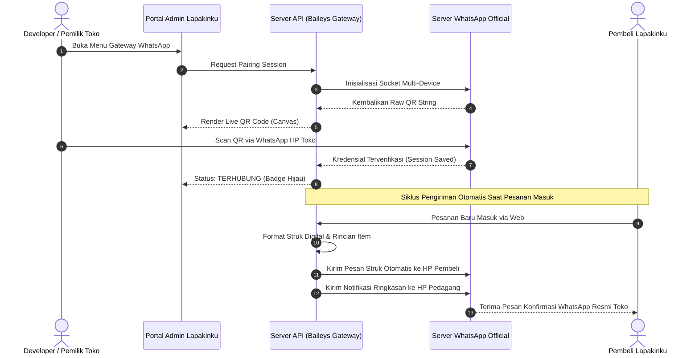

---

### 5. Alur Push Notifications & Lonceng Kasir

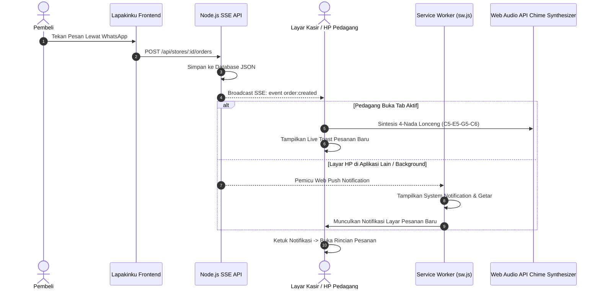

---

## 🚀 Katalog 12 Fitur Unggulan

### 1. 💰 Engine Bagi Uang Laci (Pemisah Omzet, Modal HPP & Untung Bersih)
- **Pemisahan Dana Realtime:** Setiap rupiah omzet otomatis dipisahkan menggunakan rumus akuntansi kas:
  $$\text{Modal Belanja Besok} = \sum_{i=1}^{n} (\text{HPP}_i \times \text{Qty}_i)$$
  $$\text{Untung Bersih} = \text{Total Bayar} - \text{Modal Belanja Besok}$$
- **Rasio Visual Dua Warna:** Bar progres proporsional yang memperlihatkan persentase modal yang harus diputar vs keuntungan bersih yang aman dinikmati.
- **Proteksi Margin & Deteksi Jual Rugi:** Memberi peringatan mencolok jika harga jual suatu menu berada di bawah HPP (`Rugi Rp... / porsi (Jual di bawah modal)`).
- **Distribusi Jam Ramai:** Histogram pesanan per rentang 2 jam (08.00 s/d 22.00) untuk memantau jam sibuk dapur toko.
- **Peringkat Menu Terlaris:** Menampilkan 5 produk juara berdasarkan volume pesanan riil.

### 2. 🤖 Gateway Bot WhatsApp Native Terintegrasi (Baileys Engine)
- **Multi-Device Socket Direct:** Terkoneksi langsung ke jaringan WhatsApp menggunakan engine modern tanpa ketergantungan API pihak ketiga berbayar yang mahal.
- **Dynamic Live QR Generator:** Pratinjau QR Code dinamis langsung di layar panel admin dengan tombol perbarui instan.
- **Dukungan Pairing Code:** Opsi sambung nomor alternatif menggunakan kode pairing 8-digit untuk setup headless.
- **Auto-Dispatch Notifikasi & Struk Digital:** Pesanan baru otomatis memicu bot untuk mengirim struk pembelian ke WhatsApp pelanggan dan pemberitahuan ringkas ke kasir.
- **Indikator Kesehatan Sesi:** Memantau status koneksi secara *realtime* (*Terhubung, Menunggu Scan, atau Terputus*).

### 3. ⏰ Evaluator Jam Operasional Cerdas (Smart Store Hours Engine)
- **Kalkulasi Waktu Dinamis (`isStoreOpenNow`):** Menghitung status buka/tutup toko berdasarkan jam real-time perangkat pembeli dan jadwal toko (`08.00–21.00`, `24 Jam`, dll.).
- **Banner Status & Kunci Checkout:** Jika toko sedang tutup, katalog menampilkan penanda jelas (*"Tutup • Buka pk 08.00"*) dan tombol checkout terkunci aman untuk mencegah pesanan fiktif saat toko istirahat.
- **Emergency Manual Override:** Saklar darurat satu-sentuhan bagi pedagang untuk menutup toko sementara saat kehabisan bahan baku tanpa merusak jadwal reguler.

### 4. 🎨 Sistem Desain Vektor Murni & Zero-Emoji Typography
- **100% SVG Vector Icons (Lucide React):** Mengeliminasi seluruh penggunaan karakter unicode emoji yang kerap pecah, berformat inkonsisten, atau tampak amatir di berbagai tipe perangkat Android jadul.
- **Ikon Khusus Industri Kuliner & Ritel:** Menggunakan ikon `Bike` (layanan antar), `UtensilsCrossed` (placeholder menu lezat), `Banknote` (tunai), `QrCode` (QRIS), `CreditCard`, `Info`, `Clock`, dan `Sparkles`.
- **Unclipped Gradient Hero Layout:** Geometri cover header katalog dirancang presisi dengan safe-area berlapis sehingga avatar profil toko tidak terpotong oleh cover di semua resolusi HP.

### 5. 🎭 Engine Kustomisasi Tema Toko (Theme Presets)
- **Pilihan Tema Siap Pakai:**
  - 🌿 **Emerald Culinary (Default):** Hijau segar standar kuliner higienis dan terpercaya.
  - ☕ **Bistro Amber:** Nuansa cokelat madu hangat untuk *bakery*, kedai kopi, dan martabak.
  - 🌙 **Midnight Modern:** Palet gelap elegan untuk cafe kekinian dan restoran bergaya minimalis.
- **Injeksi Variabel CSS Instan:** Ganti tema seketika tanpa perlu memuat ulang halaman (*zero page reload*).

### 6. 🛍️ Portal Belanja Pembeli Tanpa Aplikasi (Buyer Web Portal)
- **Akses Instan Zero-Install:** Pembeli cukup mengakses URL pendek toko (misal: `lapakinku.my.id/dimsume`) atau scan QR di meja.
- **Deteksi GPS & Ongkir Haversine Otomatis:** Menghitung jarak presisi antara titik GPS pembeli dan koordinat toko pedagang, lengkap dengan penyesuaian manual (`-0.5 km` / `+0.5 km`) serta proteksi gratis ongkir minimal belanja.
- **Format WhatsApp Terstruktur:** Menghasilkan pesan pesanan terformat rapi lengkap dengan rincian menu, tipe layanan, dan tautan pin Google Maps alamat pembeli.
- **Halaman Bayar QRIS Interaktif:** Dilengkapi simulasi verifikasi transfer, panduan cara bayar, dan unduh gambar QRIS.

### 7. 🧾 Mesin Kasir POS Offline-First (Merchant POS)
- **Antarmuka Sentuh Ramah Jempol:** Didesain khusus untuk kecepatan transaksi kasir saat jam sibuk antrean warung.
- **Tipe Layanan Lengkap:** Pesan Antar (*Delivery*), Ambil Sendiri (*Takeaway*), dan Makan di Tempat (*Dine-in* meja M-1 s/d M-5).
- **Kalkulator Kembalian Instan:** Tombol nominal cepat (*Uang Pas, 50rb, 100rb, 200rb*) dengan hitung kembalian instan tanpa perlu alat bantu kalkulator luar.
- **Offline-First Resilience:** Transaksi kasir tetap tersimpan di lokal (IndexedDB) saat kuota internet padam dan otomatis disinkronkan ke server saat kembali online.
- **Cetak Struk Thermal Bluetooth (58mm / 80mm):** Cetak struk langsung ke printer thermal Bluetooth portable atau salin teks struk instan.

### 8. 📊 Ekspor Fisik Laporan Penjualan (Excel Multi-Sheet & CSV UTF-8 BOM)
- **Microsoft Excel Workbook (.xlsx):** Dokumen spreadsheet resmi dengan 2 lembar kerja (*Sheet 1: Ringkasan Eksekutif Bagi Uang Laci, Sheet 2: Rincian Lengkap Setiap Transaksi*).
- **CSV Universal dengan UTF-8 BOM (`\uFEFF`):** Mencegah terjadinya karakter rusak (*mojibake*) saat file laporan dibuka di Microsoft Excel versi lama, WPS Office, maupun LibreOffice.
- **Penyaring Waktu Fleksibel:** Hari Ini, 7 Hari Terakhir, 30 Hari Terakhir, dan Rekap Seluruh Waktu.

### 9. 🔔 Synthesized Web Audio Chime & Realtime SSE
- **Web Audio API Native:** Menghasilkan suara lonceng kasir 4-nada jernih (*C5 523Hz -> E5 659Hz -> G5 784Hz -> C6 1046Hz*) yang disintesis langsung di memori browser tanpa perlu mengunduh file MP3 eksternal.
- **Server-Sent Events (SSE):** Setiap pesanan yang dikirim pembeli langsung memicu lonceng dan memunculkan pesanan baru di layar kasir secara *real-time*.
- **Service Worker Background Push:** Memunculkan notifikasi sistem di status bar HP saat kasir membuka aplikasi lain.

### 10. 👑 Portal Super Admin & Manajemen Multi-Tenant (Developer Admin)
- **Ringkasan Multi-Toko:** Memantau jumlah total toko terdaftar, volume pesanan harian, dan kesehatan koneksi server.
- **Pusat Kendali WhatsApp Gateway:** Menyambungkan, me-restart, atau memutuskan koneksi sesi bot WhatsApp toko dari satu tempat terpusat.
- **Audit Data & Sinkronisasi:** Memeriksa integritas berkas data transaksi per toko dan status server background.

### 11. 🛡️ Keamanan & Resiliensi Antarmuka
- **Zero Native Browser Alert:** 100% dialihkan ke modal internal `AppDialog` yang anggun, mencegah pemblokiran dialog oleh browser mobile.
- **Anti-Bot & Anti-Spam Shield:** Validasi honeypot tersembunyi (`_hp_website`) dan pembatasan selang waktu kirim formulir (*minimum submission elapsed time*).
- **Nginx Aggressive Cache Revalidation:** Pengaturan header `no-cache, no-store, must-revalidate` pada berkas `index.html` menjamin pengguna selalu menerima pembaruan versi build terkini tanpa kendala *ChunkLoadError*.

### 12. 📱 Aplikasi Android Native APK (Capacitor 7 Engine)
- **Build APK Release Ringan:** Hanya berukuran ~5 MB, kompatibel mulai Android 8.0 Oreo hingga Android 14.
- **Integrasi Hardware Native:** Dukungan tombol *hardware back*, penyesuaian lekukan layar (*notch/safe-area insets*), dan status bar tematik.

---

## 🛠️ Teknologi yang Digunakan

| Komponen | Pustaka / Teknologi | Peran & Alasan Pemilihan |
|---|---|---|
| **Frontend Framework** | React 18.3.1 | Arsitektur komponen reaktif dengan React Hooks & Context API modular |
| **Pembangun Modul** | Vite 6.0.7 | Kompilasi ultra-cepat dengan Hot Module Replacement (HMR) |
| **Sistem Desain** | Tailwind CSS 3.4.17 | Utilitas CSS modern responsif ramah jempol smartphone |
| **Ikonografi Vektor** | Lucide React | Ikon SVG berbasis vektor yang tajam dan seragam di semua platform |
| **Mobile Runtime** | Capacitor 7.0.1 | Jembatan PWA ke binary native Android APK release |
| **Spreadsheet Engine** | SheetJS (`xlsx`) | Pembangun dokumen Microsoft Excel (.xlsx) client-side tanpa server berat |
| **Realtime Channel** | Server-Sent Events (SSE) | Saluran streaming satu arah berlatensi rendah untuk lonceng kasir |
| **WhatsApp Engine** | `@whiskeysockets/baileys` | Gateway bot WhatsApp multi-device mandiri berkecepatan tinggi |
| **Synthesizer Suara** | Web Audio API | Generator nada lonceng kasir 4-harmoni bebas latensi unduh MP3 |
| **Web Server** | Nginx & Let's Encrypt | Reverse proxy dengan kompresi Gzip dan proteksi SSL otomatis |

---

## 📂 Struktur Direktori Proyek

```text
lapakin/
├── android/                   # Konfigurasi proyek native Android Studio & Capacitor
│   └── app/
│       ├── build.gradle       # Versi APK (versionCode 16, versionName "1.1.6")
│       └── src/main/AndroidManifest.xml
├── assets/                    # Dokumentasi & tangkapan layar antarmuka
│   └── screenshots/           # Aset visual katalog, POS, dashboard & WhatsApp
├── public/                    # Berkas statis publik
│   ├── favicon.ico
│   ├── logo.svg
│   ├── manifest.json          # PWA Web App Manifest
│   └── sw.js                  # Service Worker untuk Push Notification & Cache
├── src/
│   ├── components/            # Komponen antarmuka modular
│   │   ├── AppDialog.jsx      # Modal pengganti native window.alert/confirm
│   │   ├── EditLinkModal.jsx  # Modal ganti tautan slug toko (Fitur PRO)
│   │   ├── ErrorBoundary.jsx  # Penanganan error runtime & refresh cerdas
│   │   ├── StoreQrModal.jsx   # Modal download & cetak QR Toko
│   │   └── ThermalReceipt.jsx # Template cetak struk thermal 58mm/80mm
│   ├── context/
│   │   └── AppContext.jsx     # State manajemen global, SSE listener, Push & Chime
│   ├── pages/                 # Halaman utama aplikasi
│   │   ├── BuyerCatalog.jsx   # Katalog belanja pembeli online (Vektor SVG & Jam Toko)
│   │   ├── BuyerCheckout.jsx  # Formulir checkout, GPS ongkir & pesan WhatsApp
│   │   ├── BayarQRIS.jsx      # Halaman simulasi & instruksi bayar QRIS
│   │   ├── OrderSuccess.jsx   # Halaman pesanan berhasil terkirim + konfeti
│   │   ├── MerchantDashboard.jsx # Dashboard utama pedagang & ringkasan laci
│   │   ├── MerchantPOS.jsx    # Mesin kasir layar sentuh offline-first
│   │   ├── MerchantMenu.jsx   # Kelola harga jual, modal HPP & ketersediaan menu
│   │   ├── MerchantOrders.jsx # Riwayat dan manajemen status pesanan
│   │   ├── MerchantReport.jsx # Laporan penjualan, Bagi Uang Laci & Ekspor Excel
│   │   ├── MerchantSettings.jsx # Pengaturan toko, GPS, pembayaran & tema
│   │   ├── MerchantUpgrade.jsx# Halaman aktivasi fitur Toko PRO
│   │   └── DeveloperAdmin.jsx # Portal super admin platform & WhatsApp gateway
│   ├── utils/
│   │   ├── exportReport.js    # Utilitas pembuat berkas fisik Excel & CSV UTF-8 BOM
│   │   ├── operatingHours.js  # Evaluator jam operasional toko dinamis
│   │   ├── phone.js           # Normalisasi nomor WhatsApp Indonesia (+62)
│   │   ├── receipt.js         # Generator teks struk thermal terformat
│   │   └── themePresets.js    # Preset tema visual (Emerald, Bistro, Midnight)
│   ├── App.jsx                # Komponen root & router navigasi SPA
│   ├── index.css              # Style Tailwind & deklarasi safe-area Android
│   └── main.jsx               # Entry point aplikasi
├── capacitor.config.json      # Konfigurasi appId id.lapakinku.app
├── package.json               # Konfigurasi dependensi npm
└── vite.config.js             # Konfigurasi build bundler Vite
```

---

## 💻 Panduan Instalasi & Pengembangan Lokal

### 1. Prasyarat
- **Node.js**: Versi `18.x` atau `20.x` LTS
- **npm**: Versi `9.x` atau lebih baru
- **Git**

### 2. Langkah Instalasi
```bash
# 1. Clone repositori dari GitHub
git clone https://github.com/MohammadNasrullohh/lapakinku.git
cd lapakinku

# 2. Pasang seluruh dependensi
npm install

# 3. Jalankan development server lokal
npm run dev
```

Aplikasi lokal akan berjalan pada `http://localhost:5173/`.

---

## 📱 Panduan Kompilasi Android APK

Untuk mengompilasi APK release Android menggunakan Android SDK:

```bash
# 1. Bangun aset frontend produksi
npm run build

# 2. Sinkronisasikan aset ke proyek Android native
npx cap sync android

# 3. Masuk ke direktori android dan bangun berkas APK release
cd android
./gradlew assembleRelease
cd ..
```

Berkas APK hasil kompilasi akan berada di:  
`android/app/build/outputs/apk/release/app-release.apk`

---

## 🚀 Panduan Deployment VPS (Production)

### 1. Konfigurasi Nginx
Pastikan file konfigurasi Nginx menyertakan header anti-cache pada `index.html` dan proxy SSE:

```nginx
# HTML file: Wajib selalu revalidate agar pembeli & kasir langsung mendapat versi terbaru
location = /index.html {
    add_header Cache-Control "no-cache, no-store, must-revalidate" always;
    add_header Pragma "no-cache" always;
    expires 0;
}

location / {
    try_files $uri $uri/ /index.html;
    add_header Cache-Control "no-cache, no-store, must-revalidate" always;
    add_header Pragma "no-cache" always;
    expires 0;
}

# Proxy Realtime SSE
location /api/ {
    proxy_pass http://127.0.0.1:4010/;
    proxy_http_version 1.1;
    proxy_set_header Connection '';
    proxy_buffering off;
    proxy_cache off;
    proxy_read_timeout 86400s;
}

# Hashed static assets (JS/CSS) di-cache agresif
location ~* /assets/.*\.(?:css|js)$ {
    expires 1y;
    access_log off;
    add_header Cache-Control "public, max-age=31536000, immutable";
}
```

### 2. PM2 Process Manager
Jalankan backend API dan WhatsApp Gateway menggunakan PM2:
```bash
pm2 start server.js --name "lapakin-api"
pm2 save
```

---

## 📄 Lisensi

Proyek ini dilisensikan di bawah lisensi **MIT** — silakan gunakan, kembangkan, dan manfaatkan untuk memajukan UMKM di seluruh nusantara.

---

**Lapakinku Indonesia** · *Solusi Kasir, Katalog WhatsApp, dan Keuangan Praktis untuk Pedagang Hebat Indonesia.*
