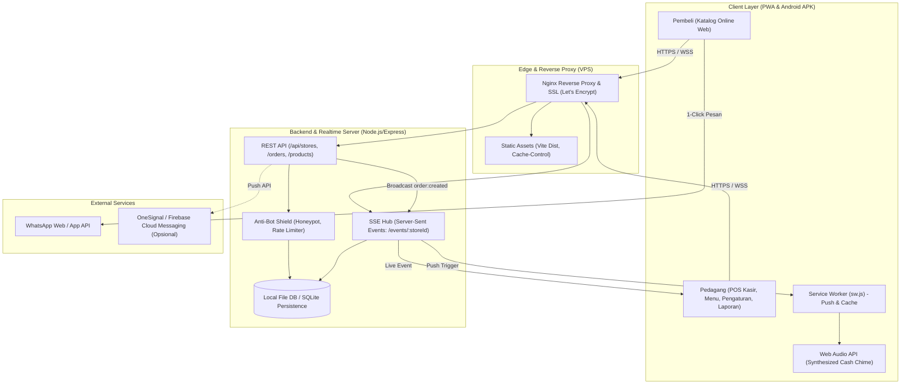
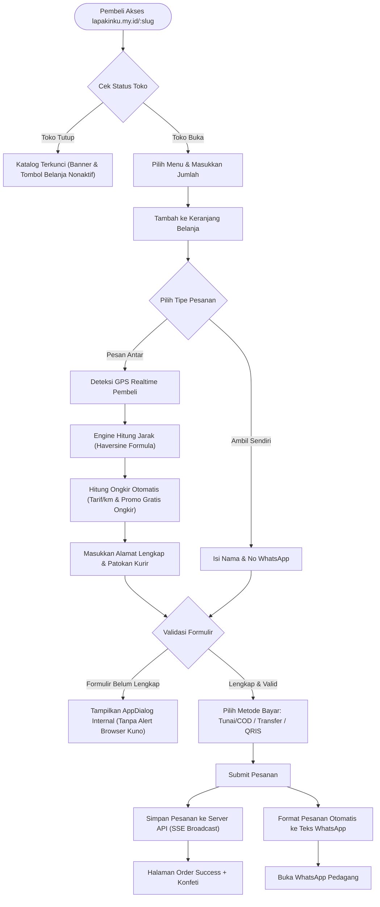
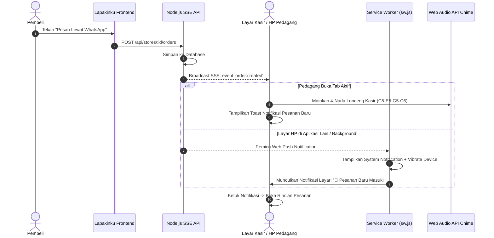

# Lapakinku — Katalog Digital, Kasir POS & Engine Bagi Uang Laci UMKM

[](https://lapakinku.my.id/)
[](https://lapakinku.my.id/lapakinku-v1.0.0.apk)
[](LICENSE)
[](https://reactjs.org/)
[](https://vitejs.dev/)
[](https://capacitorjs.com/)

> **"Jualan rapi, modal aman, cukup lewat WhatsApp."**  
> Platform terintegrasi Web Application (PWA) + Android APK Native untuk jutaan UMKM kuliner dan pedagang ritel di Indonesia.
>
> 🔒 **Repository Publik (Dokumentasi & Arsitektur):** Repositori ini memuat spesifikasi sistem, diagram alur arsitektur (Mermaid flowcharts), daftar fitur, serta panduan pengembang dan tautan unduhan APK resmi. Seluruh *source code* inti disimpan secara privat.

---

## 🌐 Tautan Resmi Produksi

- **Aplikasi Web (Live Production):** [https://lapakinku.my.id/](https://lapakinku.my.id/)
- **Katalog Uji Coba Pedagang:** [https://lapakinku.my.id/dimsume](https://lapakinku.my.id/dimsume)
- **Unduh Android APK Langsung (v1.1.6):** [https://lapakinku.my.id/lapakinku-v1.0.0.apk](https://lapakinku.my.id/lapakinku-v1.0.0.apk)

---

## 📌 Daftar Isi
1. [Latar Belakang & Nilai Utama](#-latar-belakang--nilai-utama)
2. [Arsitektur Sistem & Diagram Alur (Flowcharts)](#-arsitektur-sistem--diagram-alur-flowcharts)
   - [Arsitektur Keseluruhan](#1-arsitektur-sistem-keseluruhan)
   - [Alur Belanja Pembeli & Realtime GPS](#2-alur-belanja-pembeli--checkout-whatsapp)
   - [Alur Engine Bagi Uang Laci](#3-alur-engine-bagi-uang-laci-otomatis)
   - [Alur Push Notifikasi & Realtime SSE](#4-alur-push-notifications--lonceng-kasir)
3. [Daftar Fitur Unggulan](#-daftar-fitur-unggulan)
4. [Teknologi yang Digunakan](#-teknologi-yang-digunakan)
5. [Struktur Direktori Proyek](#-struktur-direktori-proyek)
6. [Panduan Instalasi & Pengembangan Lokal](#-panduan-instalasi--pengembangan-lokal)
7. [Panduan Kompilasi Android APK](#-panduan-kompilasi-android-apk)
8. [Panduan Deployment VPS (Production)](#-panduan-deployment-vps-production)

---

## 💡 Latar Belakang & Nilai Utama

Masalah terbesar pedagang kuliner dan UMKM di Indonesia bukan kekurangan pembeli, melainkan **pengelolaan arus kas harian**:
1. **Uang Laci Campur Aduk:** Modal bahan baku dan keuntungan bersih bercampur di satu laci. Tanpa disadari, uang modal terpakai untuk konsumsi pribadi sehingga pedagang tekor saat belanja bahan baku esok pagi.
2. **Ketergantungan Komisi Ojek Online yang Tinggi:** Biaya potongan 20%–30% membebani margin laba makanan.
3. **Aplikasi Kasir Konvensional Terlalu Rumit:** Butuh perangkat mahal, langganan bulanan mahal, dan sulit dipahami pegawai warung.

**Lapakinku menyelesaikan ketiga masalah di atas dengan pendekatan radikal:**
- **Katalog WhatsApp Tanpa Komisi:** Pembeli memilih menu langsung via web browser tanpa download aplikasi, pesanan langsung terkirim rapi ke nomor WhatsApp pedagang.
- **Engine Bagi Uang Laci Otomatis:** Setiap transaksi langsung dipecah menjadi dua nominal: **Modal Belanja Besok (HPP)** yang wajib disisihkan dan **Untung Bersih** yang aman dinikmati.
- **Push Notification & Lonceng Kasir:** Notifikasi web push dan suara nada lonceng (*cash chime*) instan saat pesanan baru masuk.
- **Ekspor Fisik Excel (.xlsx) & CSV:** Unduh laporan penjualan resmi dalam format Microsoft Excel multi-lembar dengan satu sentuhan.

---

## 📊 Arsitektur Sistem & Diagram Alur (Flowcharts)

### 1. Arsitektur Sistem Keseluruhan



---

### 2. Alur Belanja Pembeli & Checkout WhatsApp



---

### 3. Alur Engine Bagi Uang Laci Otomatis

```mermaid
flowchart LR
    subgraph Input ["Data Transaksi Masuk"]
        T["Total Bayar (Omzet)"]
        Items["Item Menu & Porsi"]
        Cost["Modal HPP per Menu"]
    end

    subgraph Calculation ["Engine Bagi Uang Laci"]
        CalcModal["Modal Belanja Besok = SUM(HPP × Qty)"]
        CalcUntung["Untung Bersih = Total Bayar - Total Modal"]
        Eval{"Untung >= 0 ?"}
        UntungBadge["Badge Hijau: Untung Bersih (Aman Disimpan)"]
        RugiBadge["Badge Merah: Rugi (Jual di Bawah Modal)"]
    end

    subgraph Output ["Laporan & Fisik"]
        ScreenReport["Tampilan Laporan Interaktif (Kartu Hitam & Laci)"]
        ExportExcel["Ekspor Multi-sheet Excel (.xlsx)"]
        ExportCSV["Ekspor File CSV (UTF-8 BOM)"]
        WhatsAppShare["Bagikan Ringkasan Laci ke WhatsApp"]
    end

    Input --> Calculation
    CalcModal --> CalcUntung
    CalcUntung --> Eval
    Eval -- Ya --> UntungBadge
    Eval -- Tidak --> RugiBadge
    
    UntungBadge --> Output
    RugiBadge --> Output
```



---

### 4. Alur Push Notifications & Lonceng Kasir



---

## 🚀 Daftar Fitur Unggulan

### 1. 🛍️ Portal Katalog Pembeli (Buyer Portal)
- **Tampilan Toko Modern & Responsif:** Header brand, logo toko, jam operasional, dan indikator buka/tutup dinamis.
- **Katalog Cepat Ramah Sentuhan:** Kategori menu, pencarian instan, dan kartu menu dengan proteksi judul 2-baris (`line-clamp-2`).
- **Deteksi GPS & Ongkir Realtime:** Perhitungan jarak akurat antara lokasi pembeli dan toko, dilengkapi opsi penyesuaian jarak manual (`-0.5 km` / `+0.5 km`) serta promo gratis ongkir otomatis.
- **Format WhatsApp Terstruktur:** Menghasilkan pesan WhatsApp pemesanan yang rapi beserta link lokasi Google Maps pembeli.
- **Halaman Bayar QRIS Dinamis:** Dilengkapi instruksi pembayaran, unduh kode QR, dan simulator verifikasi pembayaran.

### 2. 🧾 Mesin Kasir POS Offline-First (Merchant Portal)
- **Point of Sale Responsif:** Didesain khusus untuk kecepatan ketuk jempol kasir saat antrean ramai.
- **Pilihan Layanan Fleksibel:** Pesan Antar (*Delivery*), Ambil Sendiri (*Takeaway*), dan *Dine-in* (dengan pemilihan meja M-1 s/d M-5).
- **Kalkulator Kembalian Cepat:** Tombol nominal instan (*Uang Pas, 50rb, 100rb, 200rb*) dengan hitung kembalian instan.
- **Dukungan Offline-First:** Transaksi kasir tetap berjalan lancar tanpa kuota internet dan otomatis tersinkronisasi saat kembali online.
- **Cetak Struk Thermal Bluetooth (58mm / 80mm):** Pratinjau struk thermal presisi siap cetak via printer thermal Bluetooth atau disalin ke teks WhatsApp.

### 3. 💰 Engine Bagi Uang Laci Otomatis
- **Pemisahan Dana Realtime:** Setiap rupiah omzet otomatis dipisahkan menjadi:
  - 🟠 **Modal Belanja Besok (HPP):** Wajib diputar kembali untuk bahan baku esok pagi.
  - 🟢 **Untung Bersih:** Keuntungan nyata hak pedagang yang aman dinikmati.
- **Proteksi Jual Rugi:** Mendeteksi jika harga jual lebih rendah dari harga modal dan menampilkan peringatan tegas: `Rugi Rp... / porsi (Jual di bawah modal)`.
- **Grafik Distribusi Jam Ramai:** Visualisasi pesanan per 2 jam (08.00 s/d 22.00) untuk memantau jam sibuk lapak.
- **Menu Terlaris:** Peringkat 5 produk terlaris berdasarkan pesanan riil.

### 4. 📊 Ekspor Fisik Laporan Penjualan (Excel & CSV)
- **Format Microsoft Excel (.xlsx):** File workbook ganda (*Sheet 1: Ringkasan Bagi Uang Laci*, *Sheet 2: Rincian Lengkap Transaksi*).
- **Format CSV Universal (.csv):** Menggunakan standar **UTF-8 BOM (`\uFEFF`)** sehingga karakter mata uang dan format tanggal terbuka sempurna di Microsoft Excel, WPS Office, dan Google Sheets tanpa karakter rusak.
- **Filter Rentang Waktu:** Hari Ini, 7 Hari Terakhir, 30 Hari Terakhir, dan Semua Waktu.

### 5. 🔔 Push Notifications & Audio Chime Kasir
- **Web Push Service Worker:** Menerima dan memunculkan notifikasi sistem di latar belakang layar HP.
- **Synthesized Audio Chime:** Suara lonceng kasir 4-nada jernih (*C5 523Hz -> E5 659Hz -> G5 784Hz -> C6 1046Hz*) yang disintesis langsung via Web Audio API tanpa membutuhkan aset file MP3 eksternal.
- **Integrasi Server-Sent Events (SSE):** Notifikasi pesanan pembeli langsung muncul seketika di layar kasir pedagang tanpa perlu reload halaman.
- **Kartu Pengaturan Lengkap:** Toggle suara lonceng, saklar push notifikasi, tombol uji coba lonceng, serta konfigurasi opsional Firebase Cloud Messaging / OneSignal App ID.

### 6. 🛡️ Keamanan & Integritas Antarmuka Modern
- **Zero Native Browser Alert:** 100% pop-up browser kuno (`alert()`, `confirm()`, `prompt()`) dialihkan ke komponen modal internal `AppDialog` modern.
- **Anti-Bot & Anti-Spam Shield:** Validasi honeypot tersembunyi (`_hp_website`) dan tanda tangan selang waktu (*minimum submission elapsed time*) mencegah manipulasi bot otomatis.
- **Proteksi Toko Tutup:** Menolak dan mengunci checkout WhatsApp jika toko dalam status tutup.
- **Nginx Cache-Control:** Konfigurasi `no-cache, no-store, must-revalidate` pada `index.html` dan *rolling assets deployment* mencegah terjadinya kendala *ChunkLoadError*.

---

## 🛠️ Teknologi yang Digunakan

| Kategori | Teknologi | Deskripsi |
|---|---|---|
| **Frontend Framework** | React 18.3.1 | Komponen antarmuka modular dengan React Hooks & Context API |
| **Build Tool** | Vite 6.0.7 | Pembangunan modul kilat dengan Hot Module Replacement (HMR) |
| **Styling** | Tailwind CSS 3.4.17 | Utilitas CSS modern responsif ramah mobile |
| **Mobile Runtime** | Capacitor 7.0.1 | Jembatan PWA ke aplikasi native Android APK |
| **Icons & Animasi** | Lucide React & Canvas-Confetti | Paket ikon modern & efek konfeti saat transaksi berhasil |
| **Spreadsheet Engine** | SheetJS (xlsx) | Pembangun berkas spreadsheet Excel (.xlsx) client-side |
| **Realtime Channel** | Server-Sent Events (SSE) | Saluran komunikasi streaming satu arah dari server ke klien |
| **Backend API** | Node.js / Express | Server REST API untuk sinkronisasi data toko, pesanan, dan menu |
| **Reverse Proxy & SSL**| Nginx & Let's Encrypt | Reverse proxy performa tinggi dengan sertifikat SSL otomatis |

---

## 📂 Struktur Direktori Proyek

```text
lapakin/
├── android/                   # Konfigurasi native Android Studio & Capacitor
│   └── app/
│       ├── build.gradle       # Versi APK (versionCode 16, versionName "1.1.6")
│       └── src/main/AndroidManifest.xml
├── public/                    # Aset statis publik
│   ├── favicon.ico
│   ├── logo.svg
│   ├── manifest.json          # PWA Web App Manifest
│   └── sw.js                  # Service Worker untuk Push Notification & Cache
├── src/
│   ├── components/            # Komponen antarmuka yang dapat digunakan ulang
│   │   ├── AppDialog.jsx      # Modal pengganti native window.alert/confirm
│   │   ├── EditLinkModal.jsx  # Modal ganti tautan slug toko (Fitur PRO)
│   │   ├── ErrorBoundary.jsx  # Penanganan error runtime & refresh cerdas
│   │   ├── StoreQrModal.jsx   # Modal download & cetak QR Toko
│   │   └── ThermalReceipt.jsx # Template cetak struk thermal 58mm/80mm
│   ├── context/
│   │   └── AppContext.jsx     # State manajemen global, SSE listener, Push & Chime
│   ├── pages/                 # Halaman utama aplikasi
│   │   ├── BuyerCatalog.jsx   # Katalog belanja pembeli online
│   │   ├── BuyerCheckout.jsx  # Formulir checkout, GPS ongkir & pesan WA
│   │   ├── BayarQRIS.jsx      # Halaman simulasi & instruksi bayar QRIS
│   │   ├── OrderSuccess.jsx   # Halaman pesanan berhasil terkirim
│   │   ├── MerchantDashboard.jsx # Dashboard utama pedagang & ringkasan laci
│   │   ├── MerchantPOS.jsx    # Mesin kasir layar sentuh offline-first
│   │   ├── MerchantMenu.jsx   # Kelola harga jual, modal HPP & ketersediaan menu
│   │   ├── MerchantOrders.jsx # Riwayat dan manajemen status pesanan
│   │   ├── MerchantReport.jsx # Laporan penjualan, Bagi Uang Laci & Ekspor Excel
│   │   ├── MerchantSettings.jsx # Pengaturan toko, GPS, pembayaran & Push
│   │   ├── MerchantUpgrade.jsx# Halaman aktivasi fitur Toko PRO
│   │   └── DeveloperAdmin.jsx # Portal super admin platform Lapakinku
│   ├── utils/
│   │   ├── exportReport.js    # Utilitas pembuat berkas fisik Excel & CSV
│   │   ├── phone.js           # Normalisasi nomor telepon WhatsApp Indonesia (+62)
│   │   └── receipt.js         # Generator teks struk thermal terformat
│   ├── App.jsx                # Komponen root & router navigasi SPA
│   ├── index.css              # Style Tailwind & deklarasi safe-area Android
│   └── main.jsx               # Entry point aplikasi
├── capacitor.config.json      # Konfigurasi appId id.lapakinku.app
├── package.json               # Konfigurasi dependensi npm
└── vite.config.js             # Konfigurasi build bundler Vite
```

---

## 💻 Panduan Instalasi & Pengembangan Lokal

### 1. Prasyarat
- **Node.js**: Versi `18.x` atau `20.x` LTS
- **npm**: Versi `9.x` atau lebih baru
- **Git**

### 2. Langkah Instalasi
```bash
# 1. Clone repositori dari GitHub
git clone https://github.com/MohammadNasrullohh/lapakinku.git
cd lapakinku

# 2. Pasang semua dependensi
npm install

# 3. Jalankan development server
npm run dev
```

Aplikasi web lokal akan berjalan di `http://localhost:5173/` atau `http://localhost:3000/`.

---

## 📱 Panduan Kompilasi Android APK

Untuk mengompilasi APK release Android menggunakan Android SDK:

```bash
# 1. Bangun aset frontend produksi
npm run build

# 2. Sinkronisasikan ke folder Android native
npx cap sync android

# 3. Masuk ke direktori android dan bangun APK release
cd android
./gradlew assembleRelease
cd ..
```

Berkas APK hasil kompilasi akan berada di:
`android/app/build/outputs/apk/release/app-release.apk`

---

## 🚀 Panduan Deployment VPS (Production)

### 1. Nginx Configuration Snippet
Pastikan file konfigurasi Nginx menyertakan header anti-cache pada `index.html` dan proxy SSE:

```nginx
# HTML file: Wajib selalu revalidate agar pembeli & kasir langsung mendapat versi terbaru
location = /index.html {
    add_header Cache-Control "no-cache, no-store, must-revalidate" always;
    add_header Pragma "no-cache" always;
    expires 0;
}

location / {
    try_files $uri $uri/ /index.html;
    add_header Cache-Control "no-cache, no-store, must-revalidate" always;
    add_header Pragma "no-cache" always;
    expires 0;
}

# Proxy Realtime SSE
location /api/ {
    proxy_pass http://127.0.0.1:4010/;
    proxy_http_version 1.1;
    proxy_set_header Connection '';
    proxy_buffering off;
    proxy_cache off;
    proxy_read_timeout 86400s;
}

# Hashed static assets (JS/CSS) di-cache agresif
location ~* /assets/.*\.(?:css|js)$ {
    expires 1y;
    access_log off;
    add_header Cache-Control "public, max-age=31536000, immutable";
}
```

---

## 📄 Lisensi

Proyek ini dilisensikan di bawah lisensi **MIT** — silakan gunakan, kembangkan, dan manfaatkan untuk memajukan UMKM di seluruh nusantara.

---

**Lapakinku Indonesia** · *Solusi Kasir, Katalog WhatsApp, dan Keuangan Praktis untuk Pedagang Hebat Indonesia.*
